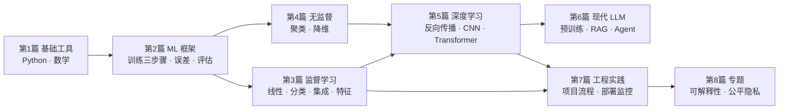

# 机器学习教学笔记（Machine Learning Teaching Notes）

一个**按学习依赖组织、长期演进**的机器学习笔记库。当前阶段是框架：
完整章节骨架 + 状态 + 写作规范，具体内容之后按需逐章填充。

- GitHub：https://github.com/tliu154/machine_learning_
- 本地：`D:\我的知识库\develop\machine_learning`（同时是 Obsidian 知识库路径）

## 快速导航

| 文件 | 作用 |
|---|---|
| **[SYLLABUS.md](SYLLABUS.md)** | **完整骨架**：8 篇 / 24 章 / 附录 A~F，每章子概念索引、状态、预定文件。**章节状态只在这里维护** |
| [CONTRIBUTING.md](CONTRIBUTING.md) | 新增章节的命名、锚点、模板、校验规范 |
| [NOTATION.md](NOTATION.md) | 符号约定与术语规范（全仓库统一） |
| [`_templates/`](_templates/) | 章节模板 / 单节模板 / 练习模板 |
| [`tools/verify_all.py`](tools/verify_all.py) | 一键自检：练习参考答案 + 相对链接 + 显式锚点 |
| [00_foundations/data_stack/](00_foundations/data_stack/) | 已完成：numpy / pandas / matplotlib 7 篇教学 + 6 份练习 |
| [00_foundations/python_basics/](00_foundations/python_basics/README.md) | 已完成：Python 基础语法 13 篇教学 + 12 份练习 |
| [00_foundations/docs/ch02_math_foundations.md](00_foundations/docs/ch02_math_foundations.md) | 已完成：ML 第 2 章 数学基础（**按需补学**：每节「理论基础 / 实际应用」） |
| [01_ml_framework/docs/ch03_what_is_ml.md](01_ml_framework/docs/ch03_what_is_ml.md) | 已完成：ML 第 3 章 机器学习是什么（第 2 篇收口） |
| [01_ml_framework/docs/ch04_training_steps.md](01_ml_framework/docs/ch04_training_steps.md) | 已完成：ML 第 4 章 训练三步骤 |
| [01_ml_framework/docs/ch05_error_sources.md](01_ml_framework/docs/ch05_error_sources.md) | 已完成：ML 第 5 章 误差来源与模型选择 |
| [01_ml_framework/docs/ch06_evaluation_metrics.md](01_ml_framework/docs/ch06_evaluation_metrics.md) | 已完成：ML 第 6 章 评估指标 |
| [90_appendix/docs/appE_exercises.md](90_appendix/docs/appE_exercises.md) | 已完成：附录 E 全部 31 份练习索引 |
| [02_supervised/docs/ch07_linear_models.md](02_supervised/docs/ch07_linear_models.md) | 已完成：ML 第 7 章 线性模型 |
| [02_supervised/docs/ch08_classical_classifiers.md](02_supervised/docs/ch08_classical_classifiers.md) | 已完成：ML 第 8 章 经典分类算法 |
| [02_supervised/docs/ch09_ensemble.md](02_supervised/docs/ch09_ensemble.md) | 已完成：ML 第 9 章 集成方法 |
| [02_supervised/docs/ch10_feature_engineering.md](02_supervised/docs/ch10_feature_engineering.md) | 已完成：ML 第 10 章 特征工程（第 3 篇收口） |
| [03_unsupervised/docs/ch11_clustering.md](03_unsupervised/docs/ch11_clustering.md) | 已完成：ML 第 11 章 聚类（第 4 篇开篇） |
| [03_unsupervised/docs/ch12_dimensionality.md](03_unsupervised/docs/ch12_dimensionality.md) | 已完成：ML 第 12 章 降维与表示（含以图搜图的召回率 / 计算量权衡） |
| [04_deep_learning/docs/ch14_nn_basics.md](04_deep_learning/docs/ch14_nn_basics.md) | 已完成：ML 第 14 章 神经网络基础（全 numpy 手写反向传播，第 5 篇开篇） |
| [04_deep_learning/docs/ch15_activation_init.md](04_deep_learning/docs/ch15_activation_init.md) | 已完成：ML 第 15 章 激活函数与初始化（8 层梯度消失 / 爆炸实测，Xavier / He） |

## 本次框架调整：采纳什么、改什么

对照给来的 8 篇 23 章大纲做的取舍。**采纳结构，不复制体量**。

| 优点 | 处理 | 理由 |
|---|---|---|
| 子概念索引前置 | **全采纳** | 写进章节模板，索引项链接到各节锚点 |
| 一个概念一个独立小节、标题带英文 | **全采纳** | `### 7.1 线性回归（Linear Regression）` 格式统一 |
| 按学习依赖排序（8 篇） | **全采纳** | 目录重排，并补上原框架缺的 **LLM 篇、工程篇、专题篇** |
| 每节统一模板 | **改造采纳** | 「数学形式」改为**可选**（Git、Jupyter 这类节没有公式）；「练习」不放在每节，改在**每章末尾一份**练习文件，节内只放链接 —— 否则 150 个概念就要 150 份碎片练习 |
| 目录可扩展、先给骨架 | **全采纳，但换实现** | **不建 150 个空壳文件**：完整骨架集中一份 `SYLLABUS.md`，只有真正开写时才建 `chNN_*.md`。空壳文件是最容易烂尾的东西 |
| 锚点稳定 | **加强** | 中文 + 括号 + 英文的标题，GitHub 自动生成的 slug 不稳定（括号被吞、中英混排易变）。**一律用显式 `<a id="c07-01"></a>`**，索引链到显式 ID，不依赖自动 slug |
| 第 0 章前言与符号约定 | **拆分** | 不单独建第 0 章（会和 README 重复维护）：定位/路径 → 本文件，模板 → CONTRIBUTING，符号术语 → `NOTATION.md` |
| 附录 E 练习题与答案 | **只做索引** | 答案统一留在各练习文件的 `# region 参考答案` 里，不在附录重复存一份，避免改一处忘另一处 |
| 第 15 / 16 章 | **保留编号，不合并** | 原备注「允许合并」已作废：ch15 的梯度消失 / 初始化实测已够一章，ch16 优化器 / 归一化是独立主题；编号保留以便对照 |
| 原模块前缀命名（np/pd/alg/dl…） | **改为全局章号** | `ch07_linear_models.md` 比 `alg01_xxx.md` 更直观，且章跨篇移动时不用改名 |

**原风格保留不变**：C++ 迁移导向（只讲差异）、按节控长度（常规章约 60~90 行/节，
整章 250~430 行，见 [NOTATION.md](NOTATION.md)）、教学配练习、`assert` 自测、`# region` 折叠答案、
固定随机种子、不依赖大文件。

## 学习依赖顺序



不严格按顺序也行 —— 每章开头用「前置」一行点明依赖，按需跳读。
实战项目是**贯穿各篇的实践轨道**（见 [SYLLABUS 第 7 篇](SYLLABUS.md)），不占章号。

## 目录结构

```
machine_learning/
├── README.md              本文件：导航、取舍说明、路径图
├── SYLLABUS.md            完整章节骨架 + 状态（唯一状态源）
├── CONTRIBUTING.md        写作与校验规范
├── NOTATION.md            符号与术语约定
├── _templates/            章节模板 / 单节模板 / 练习模板
├── tools/                 verify_all.py：全仓库自检
├── 00_foundations/        第1篇 基础工具与数学直觉
│   ├── data_stack/        [已完成] numpy/pandas/matplotlib 全套
│   ├── python_basics/     [已完成] 基础语法 ch01~ch12
│   └── docs/ + exercises/ [已完成] 第 2 章 数学基础（ch02）
├── 01_ml_framework/       第2篇 机器学习基础框架
├── 02_supervised/         第3篇 监督学习
├── 03_unsupervised/       第4篇 无监督学习（ch11 聚类 / ch12 降维已完成）
├── 04_deep_learning/      第5篇 深度学习（ch14 / ch15 已完成，全 numpy）
├── 05_llm/                第6篇 现代机器学习与 LLM
├── 06_engineering/        第7篇 工程实践（含 projects/ 实践轨道）
├── 07_topics/             第8篇 专题与负责任 ML
└── 90_appendix/           附录 A~F
```

每篇统一含 `README.md`（定位 + 依赖 + 实践方向）、`docs/`、`exercises/`。
章节清单不在篇 README 里重复，一律看 SYLLABUS。

## 单节模板（每节五段，"数学形式"可选）

```
概念定义 → 数学形式（可选）→ 最小代码 → 常见误区 → 对应练习链接
```

外加一节「和 C++ / 已有认知的差异」——这是这套笔记从第一天起的特色，不丢。
**变体**：[第 2 章数学基础](00_foundations/docs/ch02_math_foundations.md)按读者要求改成
每节「理论基础 / 实际应用」两大块 + 章首按需补学导航表，详见 [CONTRIBUTING.md](CONTRIBUTING.md) 第 2 节。

## 进度

- **已完成**：
  - 第 1 篇 1.1：Python 基础语法 13 篇教学 + 12 份练习（[python_basics](00_foundations/python_basics/README.md)）
  - 第 1 篇 1.3~1.5：三件套 7 篇教学 + 6 份练习 + 1 份速查表（[data_stack](00_foundations/data_stack/README.md)）
  - 第 2 章：数学基础 1 篇教学 + 1 份练习（[ch02](00_foundations/docs/ch02_math_foundations.md)）—— **按需补学结构**，8 节各分「理论基础 / 实际应用」
  - 第 3 章：机器学习是什么 1 篇教学 + 1 份练习（[ch03](01_ml_framework/docs/ch03_what_is_ml.md)）
  - 第 4 章：训练三步骤 1 篇教学 + 1 份练习（[ch04](01_ml_framework/docs/ch04_training_steps.md)）
  - 第 5 章：误差来源与模型选择 1 篇教学 + 1 份练习（[ch05](01_ml_framework/docs/ch05_error_sources.md)）—— **第 2 篇收口**
  - 第 6 章：评估指标 1 篇教学 + 1 份练习（[ch06](01_ml_framework/docs/ch06_evaluation_metrics.md)）
  - 第 7 章：线性模型 1 篇教学 + 1 份练习（[ch07](02_supervised/docs/ch07_linear_models.md)）
  - 第 8 章：经典分类算法 1 篇教学 + 1 份练习（[ch08](02_supervised/docs/ch08_classical_classifiers.md)）
  - 第 9 章：集成方法 1 篇教学 + 1 份练习（[ch09](02_supervised/docs/ch09_ensemble.md)）
  - 第 10 章：特征工程 1 篇教学 + 1 份练习（[ch10](02_supervised/docs/ch10_feature_engineering.md)）—— **第 3 篇收口**
  - 第 11 章：聚类 1 篇教学 + 1 份练习（[ch11](03_unsupervised/docs/ch11_clustering.md)）—— **第 4 篇开篇**
  - 第 12 章：降维与表示 1 篇教学 + 1 份练习（[ch12](03_unsupervised/docs/ch12_dimensionality.md)）
  - 第 14 章：神经网络基础 1 篇教学 + 1 份练习（[ch14](04_deep_learning/docs/ch14_nn_basics.md)）—— **第 5 篇开篇**（ch13 `[选读]` 跳过）
  - 第 15 章：激活函数与初始化 1 篇教学 + 1 份练习（[ch15](04_deep_learning/docs/ch15_activation_init.md)）—— 8 层梯度消失 / 爆炸量化，了结 ch14 的 `h=3` 悬念
  - 附录 E：31 份练习总索引（[appE](90_appendix/docs/appE_exercises.md)，只放链接不存答案）
  - 合计 **33 篇教学 + 31 份练习**，参考答案全部由 [`tools/verify_all.py`](tools/verify_all.py) 执行自测通过
- **已规划**：24 章 + 6 个附录，约 150 个概念小节，全部列在 [SYLLABUS.md](SYLLABUS.md)
- **下一步**：第 1~4 篇均已收口 / 按需跳过，第 5 篇 ch14 / ch15 已完成 →
  接 ch16 训练深度网络（优化器、归一化、残差，**从这里起引入 PyTorch**）；
  或回头补第 1 篇剩下的 1.2 环境配置 / 1.6 最小实践

## 快速开始

```bash
cd 00_foundations/data_stack/exercises
python np01_ex.py       # 输出 "np01 全部通过 ✓" 即过关

# 回到仓库根，一键自检全部练习 / 链接 / 锚点
python tools/verify_all.py
```

依赖：`pip install numpy pandas matplotlib scikit-learn`。
`scikit-learn` 从 ch07 起只在**教学文档**里做库对照，**所有练习一律只用 numpy**。
ch14 / ch15 仍然全 numpy；**ch16 起才按需加 `torch`（CPU 版即可），
装好并实跑过对照代码之后再把输出数字写进教学文档**。
仓库不收录数据集和模型权重，练习数据全部现场生成或用临时目录。

## 添加一章的最短路径

1. 在 [SYLLABUS.md](SYLLABUS.md) 找到章号 → 确认该章的预定文件名
2. 复制 `_templates/chapter_template.md` 到对应篇的 `docs/chNN_*.md`
3. 按 `_templates/concept_section.md` 逐节填写（每节显式锚点）
4. 复制 `_templates/exercise_template.py` 到 `exercises/chNN_ex.py`
5. 跑 `python tools/verify_all.py`、更新 SYLLABUS 状态、commit

详细规则见 [CONTRIBUTING.md](CONTRIBUTING.md)。
